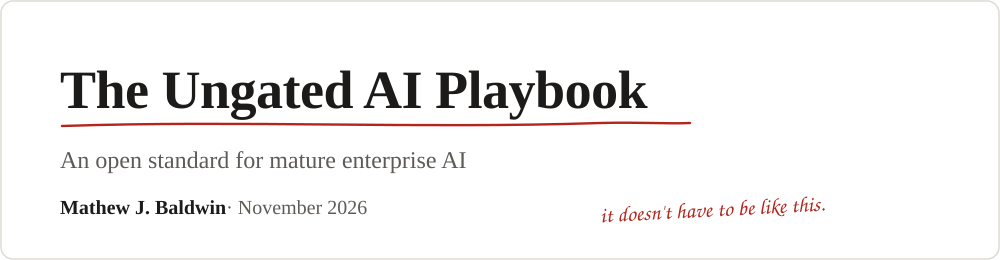
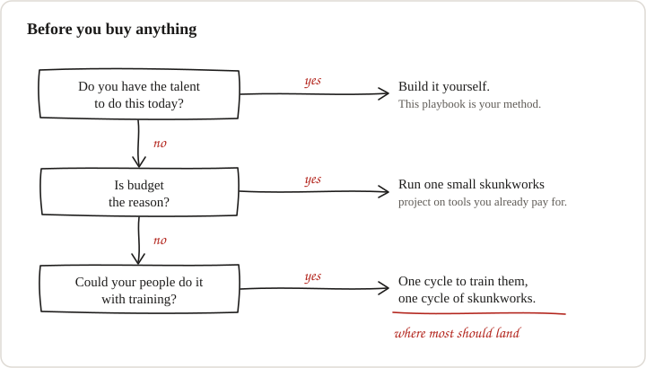
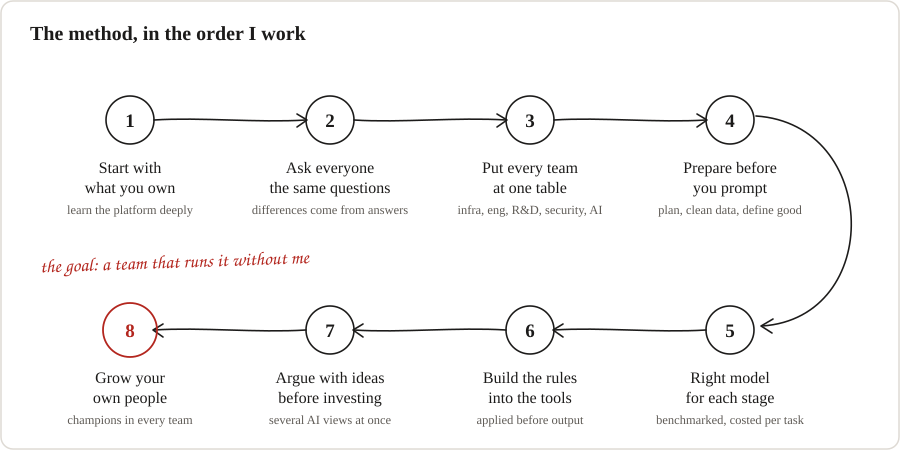
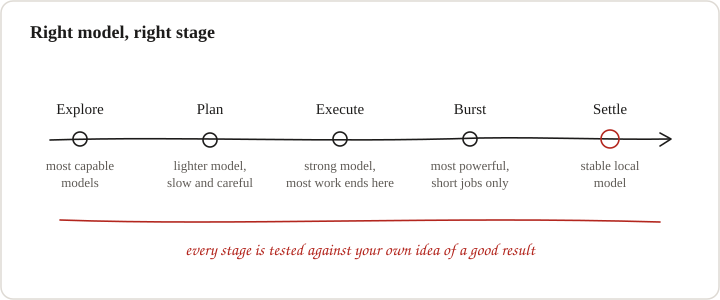
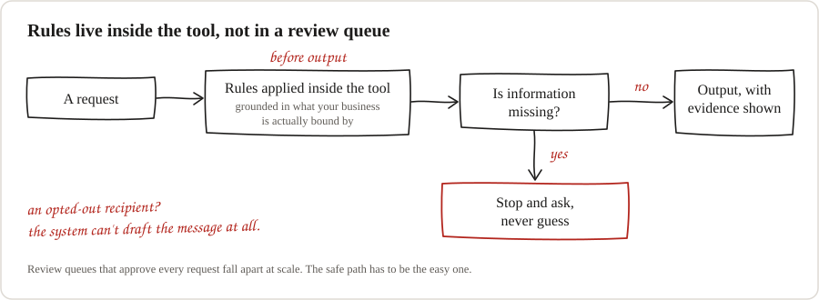
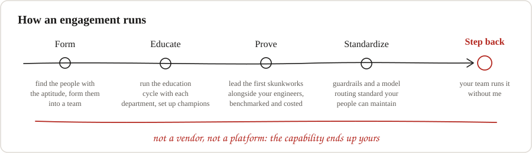

  

  <a href="#why-this-exists">Why this exists</a> &nbsp;·&nbsp;
  <a href="#what-mature-looks-like">The standard</a> &nbsp;·&nbsp;
  <a href="#before-you-buy-anything">Before you buy</a> &nbsp;·&nbsp;
  <a href="#the-method-in-eight-steps">The method</a> &nbsp;·&nbsp;
  <a href="#who-this-is-for">Who it is for</a> &nbsp;·&nbsp;
  <a href="#about-the-author">About</a> &nbsp;·&nbsp;
  <a href="#how-i-can-help">Work with me</a>

> **If AI is going to change how your core work gets done, your own people need to be the ones who know how to do it.**

**The Ungated AI Playbook** is an open standard for mature enterprise AI. It is vendor neutral, it works on Claude, Copilot, ChatGPT, Gemini, or whatever your contracts already say you use, and it is written in the open for anyone who wants to use it.

It comes from years of building AI programs inside real businesses, across every department I could get a seat with. The right way to do this is not secret, and it is not something you need to buy.

**Read the full playbook:** [ungatedbluemarble.github.io/ungated-ai-playbook](https://ungatedbluemarble.github.io/ungated-ai-playbook/)

---

## Why this exists

Walk into most enterprises today and you will find the same pattern.

- **Everything runs on the most powerful frontier model**, for every task, whether it needs it or not.
- **Nobody benchmarked the alternatives**, and nobody wrote down what a good result looks like.
- **The bill arrives bigger than anyone expected**, and the plan is to cross fingers and hope the value shows up.

The numbers back this up. In a 2026 survey of 700 engineering leaders, companies estimated they waste about a quarter of what they spend on AI. Half had no clear owner for those costs, and only about one in four had a solid way to measure what the spending was actually worth. *(The figures are self-reported and the survey is vendor-sponsored. See [Sources](#sources).)*

The second pattern worries me more. Companies that arrived late to AI are trying to buy their way back to the front, and they are increasingly buying from startups that want to do the company's own core work for them. Chip companies are being pitched AI that designs chips. The people who know silicon best are being asked to rent that knowledge back from someone else.

None of this is a technology problem. **It is a maturity problem, and it is fixable.**

---

## What mature looks like

Most organizations are somewhere in the left column. The goal is to move every row to the right.

| | Crossing your fingers | The standard |
|---|---|---|
| **Model choice** | The biggest model, for everything | Benchmarked for each stage of the work |
| **Cost** | Watched by the token, after the bill | Measured per finished task, planned up front |
| **Proven work** | Still on frontier prices forever | Moved to a stable local model |
| **Vendors** | A new AI subscription for each problem | Get the most from what you already own |
| **Rules** | Bad output caught after the fact | Built into the tools, applied before output |
| **People** | A few experts, everyone else waiting | Trained champions in every department |
| **Ownership** | Rented from a vendor | Held by your own team |

---

## Before you buy anything

The industry expects you to sign another contract. Before you do, answer three honest questions. Every path through them ends somewhere useful, and none of them starts with a purchase order.

  

| If this is true | Then do this |
|---|---|
| You have the talent today | Build it yourself. This playbook is your method. |
| Budget is the reason you have not started | Run one small skunkworks project on tools you already pay for. |
| Your people could do it with training | One cycle to train them, then one cycle of skunkworks. **This is where most should land.** |

A skunkworks project is a small, protected team given room to experiment. Run one inside your engineering group and it will surface the AI uses that fit your work faster than any vendor pitch.

If you do bring in outside help, it should teach, set things up, and leave. Anything else is just a new dependency.

---

## The method in eight steps

This is the order I work in. None of it requires a particular vendor.

  

<b>1. Start with what you already own</b>

 

Some companies choose their AI tools freely. Others inherit them through contracts they already hold. Either way, the first job is to learn that platform deeply and find what it does best for this particular business. Wishing for a different tool is not a strategy.

<b>2. Ask everyone the same questions</b>

 

The real problems live with department leaders, power users, and the experts who know a process inside out. Sit with them and ask the same core questions every time, so differences come from their answers and not from how you asked. When two leaders describe the same process differently, that disagreement is usually the most useful thing you will learn all week.

<b>3. Put every team at one table</b>

 

Infrastructure, engineering, R&D, security and AI specialists all think differently, and each one sees a risk the others miss. The decisions that stall most programs, like whether a tool runs on your own systems or in the cloud, or which automations are worth building, get settled faster when they are all in the room.

<b>4. Prepare before you prompt</b>

 

This applies to every team and every skill level, even when engineers find it tedious. Plan the work. Clean the data you will feed the model so it only holds what the task needs. Write down what a good result looks like before you see any output. Then test several models against that, instead of trusting the first one that looks right.

<b>5. Use the right model for each stage</b>

 

Models are tools for stages of work, not one purchase. See the routing diagram below.

<b>6. Build the rules into the tools</b>

 

You cannot let people build with AI and also stop them from building. Put the guardrails inside the tools people use, so the safe path is the easy one. See the diagram below.

<b>7. Argue with ideas before you invest in them</b>

 

Run new ideas past several AI perspectives at once and let them argue until the weak spots show. It is a cheap way to stress an idea before it costs a team real time.

<b>8. Grow your own people</b>

 

Lasting adoption comes from people who understand what they are doing. That means workshops shaped around each department, champions inside every team who can teach the people next to them, and tools that teach as they go. The goal is a company that keeps getting better at this long after any consultant has left.

### Step 5 in detail: the right model for each stage

Here is how a solution should move from idea to something you run every day.

  

In Claude terms, that might mean exploring with the top models, letting Sonnet plan over a few sessions, handing the plan to Opus to build, and saving Fable for short, demanding bursts. Every vendor has the same tiers under different names. Once something is proven, reliable and repeatable, stop paying frontier prices for it. Move it to a local model you control, tested the same way.

**Cost is judged by what gets finished, with failed attempts counted.** A cheap model that needs four tries is not cheap. When a team can show what AI delivered for what it cost, the conversation with leadership changes from "are we spending too much?" to "where do we invest next?"

### Step 6 in detail: rules inside the tools

  

Review queues where someone approves every request fall apart at scale and quietly kill adoption. The better design grounds each rule in requirements your business is actually bound by, and applies it before output. Make every claim show its evidence. When information is missing, stop and ask instead of guessing. Someone new to AI who gets one confident, wrong answer rarely comes back.

---

## Who this is for

| If you are... | Here is what this gives you |
|---|---|
| **A CIO, CTO or head of engineering** | A routing and benchmarking standard, so model spend is planned instead of discovered on the invoice. |
| **A CFO or finance leader** | Cost measured per finished task, with failed attempts counted, so the AI conversation can move from "are we spending too much?" to "where do we invest next?" |
| **A security, risk or compliance leader** | Guardrails built into the tools and applied before output, grounded in the requirements your business is actually bound by. |
| **A department head or transformation lead** | A way to turn the people who already have the aptitude into trained champions, department by department. |
| **A recruiter or hiring leader** | A clear picture of the kind of AI leadership I bring: build the capability inside the company, then step back. |

---

## About the author

**Mathew J. Baldwin** · Austin, Texas · US Marine veteran

I have worked in technology for more than twenty years, from IT and systems work through telecom operations to owning messaging platforms used in over 160 countries. For a long stretch I was the person responsible for knowing the messaging rules across 15+ jurisdictions, which is where my habit of building the rules in first comes from.

These days I build AI programs. I design the systems, direct the builds, and make sure the teams I leave behind can run them.

| 20+ | 160+ | 15+ | 200+ | 1,500+ |
|:---:|:---:|:---:|:---:|:---:|
| years in technology | countries on messaging platforms I owned | jurisdictions of messaging rules | AI workshops led | people helped to get comfortable with AI |

---

## How I can help

I am not a vendor, and I am not selling a platform. If you want help, it looks like this.

  

1. **Form the team.** I find the people in your organization who already have the aptitude and help you form them into a team.
2. **Run the education cycle.** Workshops shaped around each department, with champions set up inside every team.
3. **Lead your first skunkworks project** alongside your engineers, benchmarked and costed properly.
4. **Build the guardrails and a model routing standard** your own people can maintain.
5. **Then I step back.**

---

## Get in touch

I am always glad to talk with leaders, recruiters, and teams who see AI as a long-term capability worth building well.

**LinkedIn:** [linkedin.com/in/mathewjbaldwin](https://www.linkedin.com/in/mathewjbaldwin)

---

## Sources

- AI spending waste and ownership figures: Harness, 2026 State of AI in FinOps survey of 700 engineering leaders, July 2026, as reported by [Let's Data Science](https://letsdatascience.com/news/harness-report-finds-ai-spend-waste-f0a5fac5). The figures are self-reported and the survey is vendor-sponsored.
- AI chip design startups raising large rounds: [Built In on Cognichip](https://builtin.com/articles/cognichip-raises-60m-series-a-20260403) and [Pulse on Ricursive](https://www.pulse.bot/ai/deals/ricursive-raises-335m-to-develop-end-to-end-ai-model-for-chip-design-03690f15-ef55-4867-8304-517a027aacd9/).
- Cost per completed task as a routing principle: [Task-to-Model Optimization for Enterprise LLM Coding Assistants](https://arxiv.org/pdf/2608.08528), PayPal engineering researchers.

Mathew J. Baldwin · Austin, Texas · Last updated November 2026
